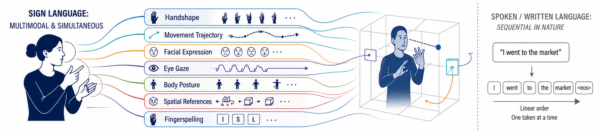
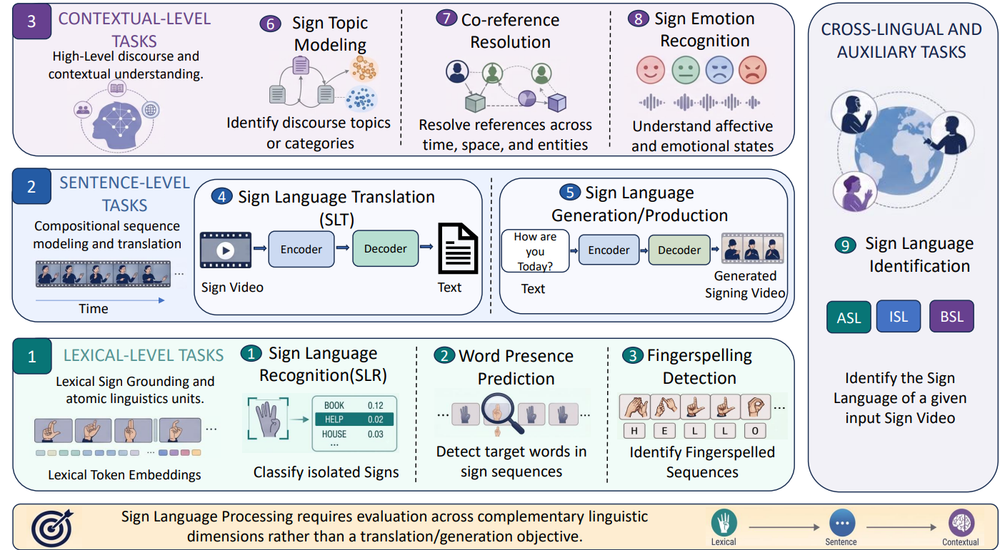
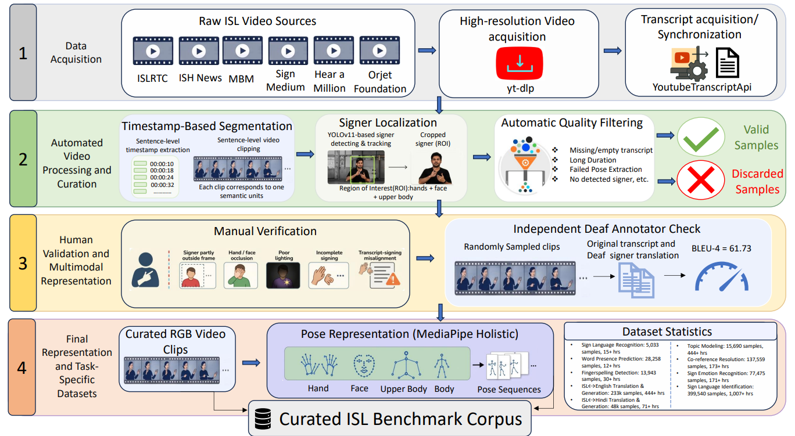

<h1 align="center">iSanketik: Towards a Multi-Level Benchmark for Sign Language Processing</h1>

<p align="center">
<a href="https://github.com/Exploration-Lab/iSanketik">Code Repository</a>
&nbsp;|&nbsp;
<a href="https://huggingface.co/datasets/Exploration-Lab/iSanketik">Dataset on Hugging Face</a>
</p>

**iSanketik** is a unified, multimodal and multilingual benchmark for
Indian Sign Language (ISL). It broadens the scope of Sign Language
Processing (SLP) beyond end-to-end sign-to-text translation and
text-to-sign generation by organizing complementary tasks into an
application-oriented taxonomy: **lexical-level**, **sentence-level**,
and **contextual-level** tasks, together with a **cross-lingual and
auxiliary** task.

The name combines “i” (Indian) with *Sanketik*, a Hindi term associated
with sign language and symbolic or gestural communication.

Sign languages convey meaning simultaneously through manual signs,
handshape, movement, facial expression, eye gaze, body posture, spatial
references, and fingerspelling. Evaluating a system only through
translation or generation metrics therefore provides an incomplete
picture of its sign-language understanding capabilities.


*Figure 1: Sign languages are inherently multimodal and simultaneous, meaning is conveyed concurrently through handshapes, facial expressions, eye gaze, body posture, spatial references, and fingerspelling. These rich linguistic signals cannot be fully captured through translation alone. In contrast, spoken and written languages rely on sequential, linear token streams.*

> **Paper:** *iSanketik: Towards a Multi-Level Benchmark for Sign
> Language Processing*
> **Dataset:** [Exploration-Lab/iSanketik on Hugging
> Face](https://huggingface.co/datasets/Exploration-Lab/iSanketik)
> **Code:** [Exploration-Lab/iSanketik on
> GitHub](https://github.com/Exploration-Lab/iSanketik)
> **License:** CC BY-NC 4.0, subject to the source-specific restrictions
> described in [Ethics and licensing](#ethics-and-licensing).

------------------------------------------------------------------------

## Table of Contents

- [Overview](#overview)
- [Key Contributions](#key-contributions)
- [Task Taxonomy](#task-taxonomy)
- [Dataset Statistics](#dataset-statistics)
- [Data Collection and Processing](#data-collection-and-processing)
- [Task Descriptions](#task-descriptions)
- [Baseline Results](#baseline-results)
- [Accessing the Data](#accessing-the-data)
- [Experimental Protocol and
Reproducibility](#experimental-protocol-and-reproducibility)
- [Ethics and Licensing](#ethics-and-licensing)
- [Limitations and Future
Directions](#limitations-and-future-directions)
- [Citation](#citation)
- [Acknowledgements](#acknowledgements)

------------------------------------------------------------------------

<a id="overview"></a>

## Overview

The benchmark is motivated by a gap in current SLP research: most
systems and benchmarks emphasize sentence-level translation or
generation, while sign languages also require localized lexical
grounding and contextual interpretation. iSanketik provides a common
benchmark suite for evaluating these complementary capabilities.

The taxonomy is **task- and application-oriented**, not a claim that
sign-language phenomena form a strict linguistic hierarchy. Spatial
structure, temporal organization, multimodality, non-manual markers, and
signer variation can influence tasks at every level.

<a id="key-contributions"></a>

## Key Contributions

- **A multi-level benchmark for ISL:** nine tasks covering lexical
grounding, sentence-level mapping, contextual understanding, and
sign-language identification.
- **Two large sentence-level resources:**
- **iSanketik-English:** 233,412 training video–sentence pairs,
approximately 444.70 hours of training video.
- **iSanketik-Hindi:** 48,466 verified video–sentence samples,
approximately 71.65 hours.
- **Direct ISL–Hindi translation and Hindi-to-ISL generation:** the
benchmark supports regional-language directions in addition to
English.
- **Complementary input representations:** RGB video and pose-based
skeletal representations are used across the tasks.
- **Signer-independent evaluation:** sentence-level data splits are
defined by video ID to reduce leakage across splits.
- **Baselines for all nine tasks:** the paper reports task-appropriate
metrics and analyses capability gaps rather than presenting a single
aggregate score.

<a id="task-taxonomy"></a>

## Task Taxonomy


*Figure 2: We formalize our proposed taxonomy for SLP (instantiated via iSanketik benchmark), organizing tasks into three levels: lexical-level, sentence-level, and contextual-level.*

```
| Level                           | What it evaluates                                                       | Tasks                                                                                        |
| ------------------------------- | ----------------------------------------------------------------------- | -------------------------------------------------------------------------------------------- |
| Lexical-level                   | Recognition and grounding of local sign units                           | Sign Language Recognition (SLR), Word Presence Prediction (WPP), Fingerspelling Detection    |
| Sentence-level                  | Compositional mapping between signed sequences and spoken-language text | ISL→English translation, ISL→Hindi translation, English→ISL generation, Hindi→ISL generation |
| Contextual-level                | Discourse, thematic, referential, and affective understanding           | Topic Modeling, Co-reference Resolution, Sign Emotion Recognition                            |
| Cross-lingual and auxiliary     | Discrimination between sign languages                                   | Sign Language Identification (SLI; eight languages)                                          |
```

The levels are complementary. For example, facial expression can change
the interpretation of a sentence without changing its manual signs,
while spatial placement and movement can encode references across
discourse.

<a id="dataset-statistics"></a>

## Dataset Statistics

The table reports the train/validation/test counts and approximate video
duration given in the paper. Hours are approximate total durations for
the corresponding task, not necessarily additional hours that can be
summed across tasks: several tasks reuse the same underlying video
corpus.

```
| Level         | Task                                   | Task type                      |   Train | Validation |   Test | Approx. hours |
| ------------- | -------------------------------------- | ------------------------------ | ------: | ---------: | -----: | ------------: |
| Lexical       | Sign Language Recognition (word/gloss) | One-shot classification        |   4,924 |        —   |    109 |           ~15 |
| Lexical       | Word Presence Prediction               | Binary classification          |  25,432 |      1,413 |  1,413 |           ~12 |
| Lexical       | Fingerspelling Detection               | Binary classification          |  11,154 |      1,394 |  1,395 |           ~30 |
| Sentence      | ISL→English Translation                | Sequence-to-sequence           | 233,412 |      5,653 |  6,069 |          ~444 |
| Sentence      | ISL→Hindi Translation                  | Sequence-to-sequence           |  40,205 |      4,251 |  4,010 |           ~71 |
| Sentence      | English→ISL Generation                 | Text-to-pose generation        | 233,412 |      5,653 |  6,069 |          ~444 |
| Sentence      | Hindi→ISL Generation                   | Text-to-pose generation        |  40,205 |      4,251 |  4,010 |           ~71 |
| Contextual    | Topic Modeling                         | Unsupervised clustering        |  15,690 |        —   |    —   |          ~444 |
| Contextual    | Co-reference Resolution                | Pairwise binary classification | 110,932 |     13,002 | 13,625 |          ~173 |
| Contextual    | Sign Emotion Recognition               | 9-class classification         |  61,980 |      7,747 |  7,748 |          ~171 |
| Cross-lingual | Sign Language Identification           | 8-class classification         | 329,506 |     30,383 | 39,651 |        ~1,007 |
```

**Notes**

- The isolated-sign recognition benchmark contains **5,033 videos** in
total: 4,924 training videos and 109 test videos. Most lexical items
have only one citation-form video.
- The WPP benchmark contains **28,258 query–sentence pairs** in total.
- The co-reference benchmark contains **137,559 pairs** in total.
- The SLI benchmark contains **399,540 samples** across eight sign
languages.
- The English and Hindi sentence-level resources contain 233,412 and
48,466 training/verified samples, respectively, as described in the
paper. The split counts in the table are the benchmark's reported
train/validation/test counts.
- The benchmark is approximately **600 GB** in its full form. Small
samples are provided for initial experimentation.

<a id="data-collection-and-processing"></a>

## Data Collection and Processing


*Figure 3: An end-to-end dataset creation and curation pipeline architecture for the Indian Sign Language (ISL) Multi-Task Benchmark. The four-stage framework details data acquisition across six public sources, automated video processing and curation (featuring timestamp segmentation, YOLOv11 signer localization, and automatic quality filtering), manual verification by ISL signers alongside independent Deaf annotator checks, and final task-specific datasets spanning lexical, sentence-level, contextual, and cross-lingual categories.*

### Sources

The ISL sentence-level resources were curated from publicly available
educational, instructional, conversational, news, and administrative
content. The sources named in the paper include:

- Indian Sign Language Research and Training Centre (ISLRTC)
- ISH News
- Mook Badhir Mandal (MBM)
- SignMedium
- Hear a Million
- Orjet Foundation

The paper reports obtaining permission from the respective source owners
or organizations to redistribute the processed research dataset. The
videos used for the ISL sentence-level resources contain signing without
accompanying audio or subtitles.

### Curation pipeline

The main processing stages are:

1. **Transcript and timestamp acquisition:** long-form videos are
segmented using sentence-level transcript timestamps.
2. **Sentence-level clipping:** each clip is intended to contain a
single semantic unit.
3. **Signer localization:** YOLOv11 is used to detect and track the
signer; the region of interest is cropped to retain the hands, face,
and upper body.
4. **Automatic quality filtering:** clips are filtered for missing
transcripts, duration outliers, failed pose extraction, and missing
signer detections.
5. **Manual verification:** ISL signers review clips for transcript
alignment, occlusion, signer truncation, lighting, and incomplete
signing.
6. **Independent alignment check:** an independent Deaf annotator
fluent in ISL and English reviewed 150 randomly selected
iSanketik-English samples. The reported BLEU-4 score against the
original transcripts is 61.73. This is an alignment check, not a
claim that the two renderings must be identical.
7. **Pose extraction:** MediaPipe Holistic is used to extract
pose/keypoint representations.

### Split protocol

For the sentence-level resources, splits are defined at the **video-ID
level** to support signer-independent evaluation. Use the released split
definitions rather than creating random clip-level splits, which may
introduce leakage between training and evaluation data.

### Task-specific annotation

Some contextual labels are initialized from aligned text and
subsequently checked against the signing videos. In particular, the
paper describes text-initialized and signer-verified procedures for
co-reference and emotion annotations, and text-derived topic names for
topic modeling. These should be interpreted as task-specific proxy
annotations, not exhaustive linguistic annotations of ISL discourse,
spatial agreement, or non-manual grammar.

<a id="task-descriptions"></a>

## Task Descriptions

### Lexical-level tasks

**1. Sign Language Recognition (SLR)**
Predict the gloss or word corresponding to an isolated ISL sign video.
The benchmark is built from ISLRTC dictionary videos and is deliberately
low-resource: the paper reports an average of approximately 1.1 videos
per word. There are 3,872 words with one citation video, 417 with two
realizations, and 109 with three.

**2. Word Presence Prediction (WPP)**
Given an isolated sign video as a query and a continuous signing clip as
a candidate, predict whether the queried sign occurs in the candidate
sequence. The benchmark uses isolated ISLRTC signs as queries and
iSanketik-English clips as candidate sentences. The released benchmark
is balanced between positive and negative pairs.

**3. Fingerspelling Detection**
Determine whether a signing clip contains fingerspelled content.
Candidate clips are identified using transcript-based linguistic
analysis (including named entities, acronyms, abbreviations, and
technical terms) and then manually checked against the videos.

### Sentence-level tasks

**4. Sign Language Translation (SLT)**
Translate an ISL video or pose sequence into spoken-language text.
iSanketik supports both:

- ISL→English (iSanketik-English)
- ISL→Hindi (iSanketik-Hindi)

The Hindi direction is designed to support direct ISL-to-Hindi modeling
rather than requiring an English pivot.

**5. Sign Language Generation / Production (SLG)**
Generate an ISL pose sequence from spoken-language text:

- English→ISL
- Hindi→ISL

The paper evaluates a two-stage generation pipeline: a pose Variational
Autoencoder (VAE), followed by a Diffusion Transformer (DiT) trained
using rectified flow matching.

### Contextual-level tasks

**6. Topic Modeling**
Cluster long-form signing sequences by their underlying topic.
Sentence-level clips from the same source video are concatenated
chronologically. Pose embeddings are clustered, and topic names are
derived from associated English text and verified by ISL experts.

**7. Co-reference Resolution**
Predict whether a later signing segment refers to an entity or concept
introduced earlier in the discourse. Candidate links are initialized
using high-confidence coreference predictions over concatenated English
transcripts and then reviewed against the videos, including spatial and
discourse cues. This is a text-initialized, signer-checked proxy task.

**8. Sign Emotion Recognition**
Classify signing segments into one of nine emotion categories. Labels
are initialized using context from English translations and then
reviewed by annotators with attention to non-manual cues such as facial
expression, head tilt, and body posture. The paper reports Cohen's κ =
0.968 for the model/human verification stage and a further Deaf-signer
check on 65 clips.

### Cross-lingual and auxiliary task

**9. Sign Language Identification (SLI)**
Identify the sign language in a video or pose sequence. The benchmark
covers eight languages:

- Indian Sign Language (ISL)
- American Sign Language (ASL)
- British Sign Language (BSL)
- Chinese Sign Language (CSL)
- Deutsche Gebärdensprache (DGS)
- Swiss German Sign Language (DSGS)
- Flemish Sign Language (VGT)
- Saudi Sign Language (SSL)

The paper combines data from multiple existing corpora and applies a
unified pose-processing pipeline. Third-party source restrictions,
particularly for BOBSL, apply; see [Ethics and
licensing](#ethics-and-licensing).

<a id="baseline-results"></a>

## Baseline Results

The following results are reproduced from the main paper's baseline
summary table. They are reference baselines, not leaderboard ceilings.

```
| Task                         | Baseline approach                                     | Reported results                                          |
| ---------------------------- | ----------------------------------------------------- | --------------------------------------------------------- |
| Sign Language Recognition    | I3D embeddings + cosine nearest-neighbor retrieval    | Top-1: 25.69%; Top-2: 32.11%; Top-5: 39.45%   |
| Word Presence Prediction     | Translation-pretrained BERT-style Transformer encoder | Accuracy: 82.38%; Macro-F1: 82.37%                |
| Fingerspelling Detection     | Translation-pretrained BERT-style Transformer encoder | Accuracy: 79.57%; Macro-F1: 79.50%                |
| ISL→English Translation      | Hybrid BERT–GPT-2 encoder–decoder                     | BLEU-4: 4.20; SacreBLEU: 4.20; ROUGE-L: 19.39 |
| ISL→Hindi Translation        | Hybrid BERT–GPT-2 encoder–decoder                     | BLEU-4: 1.53; SacreBLEU: 1.52; ROUGE-L: 7.40  |
| English→ISL Generation       | VAE + Diffusion Transformer (rectified flow)          | MPJPE: 0.469; DTW: 3.64                           |
| Hindi→ISL Generation         | VAE + Diffusion Transformer (rectified flow)          | MPJPE: 0.53; DTW: 4.94                            |
| Topic Modeling               | MoCo v2 pose embeddings + BERTopic                    | Silhouette: 0.559; Spearman ρ: 0.250              |
| Co-reference Resolution      | Translation-pretrained BERT-style Transformer encoder | Accuracy: 66.16%; Macro-F1: 66.16%                |
| Sign Emotion Recognition     | Translation-pretrained BERT-style Transformer encoder | Accuracy: 57.34%; Macro-F1: 38.31%                |
| Sign Language Identification | Transformer-based encoder                             | Accuracy: 97.94%; Macro-F1: 97.36%                |
```

### Main observations

- Sign Language Identification is comparatively easy for the reported
pose-based baseline.
- Word Presence Prediction and Fingerspelling Detection perform better
than open-set, one-shot sign recognition.
- ISL→Hindi translation remains challenging, with lower reported scores
than ISL→English.
- Generated poses can occupy plausible signing space, but fine-grained
finger articulation and sequence duration remain difficult.
- Topic alignment, discourse co-reference, and emotion recognition
remain challenging, particularly when relying on pose representations
and proxy annotations.

<a id="accessing-the-data"></a>

## Accessing the Data

The primary dataset release is hosted on Hugging Face:

**[Download / access iSanketik on Hugging
Face](https://huggingface.co/datasets/Exploration-Lab/iSanketik)**

The release is described as containing pose sequences, metadata,
task-specific annotations, split information, and small sample sets for
rapid experimentation. The full benchmark is approximately 600 GB.

Before running an experiment:

1. Read the Hugging Face dataset card and its access instructions.
2. Check the license and source-specific terms for the particular
subset you intend to use.
3. Preserve the provided UID/video-ID conventions and official split
assignments.
4. Do not redistribute third-party videos or derived media unless the
corresponding source license and permissions explicitly allow it.

The paper does not define one universal download command or a single
entry-point script for all nine tasks. Please use the current dataset
card and the task-specific code/configuration available in this
repository rather than assuming that one command applies to every task.

<a id="experimental-protocol-and-reproducibility"></a>

## Experimental Protocol and Reproducibility

- **Input modalities:** RGB video and skeletal pose sequences; pose is
the default representation for most trained baselines.
- **Pose extraction:** MediaPipe Holistic is used for the reported pose
representation.
- **Sentence-level splits:** video-ID-based, to maintain
signer-independent evaluation.
- **Metrics:** top-k accuracy and Macro-F1 for lexical
classification/retrieval; BLEU, SacreBLEU, and ROUGE-L for
translation; MPJPE and DTW for generation; Silhouette and Spearman
correlation for topic modeling; accuracy and Macro-F1 for
classification tasks.
- **Task details:** the supplementary material describes data
construction, model architectures, training configurations,
hyperparameters, confusion matrices, and additional analyses.

For faithful comparisons, use the same task definitions, preprocessing,
split files, and evaluation metrics as the benchmark. Report the input
representation and any changes to the official protocol.

<a id="ethics-and-licensing"></a>

## Ethics and Licensing

The paper describes iSanketik as a research resource intended to support
digital accessibility for Deaf and Hard-of-Hearing communities. The
dataset design and task taxonomy were developed with input from ISL
experts, and ISL signers participated in manual verification.

**License and source restrictions**

- The benchmark is released under **CC BY-NC 4.0** for non-commercial
use, subject to the terms applicable to each source.
- Source owners or organizations provided permission for redistribution
of the processed research data, as described in the paper.
- Some third-party corpora have independent terms. In particular,
**BOBSL videos, raw frames, and derived media are not redistributed**
by this work. Eligible users must obtain BOBSL from its official
maintainers and follow the BOBSL terms.
- Other third-party SLI sources are redistributed only when their
original licenses permit it.
- The dataset contains naturally occurring signing videos in which
people may be identifiable. Use the data only under the relevant
permissions and licensing terms.
- Context-oriented annotations are task labels and should not be
interpreted as definitive claims about a person's internal emotional
state or intent.

See the dataset card and the original source licenses before using or
redistributing any subset. The CC BY-NC 4.0 statement does not supersede
third-party terms.

<a id="limitations-and-future-directions"></a>

## Limitations and Future Directions

iSanketik is a starting point rather than a complete account of
sign-language competence.

- The benchmark focuses primarily on ISL and a limited set of public
sources; regional variation within India is not exhaustively
represented.
- Some contextual labels are weakly supervised or initialized from text.
In particular, co-reference is initialized from English transcript
coreference, emotion labels use model-generated suggestions followed
by signer verification, and topic names inherit structure from
translations.
- Pose landmarks are a useful, comparatively privacy-conscious
representation, but they can lose fine-grained handshape and
non-manual information.
- The current tasks do not fully evaluate spatial role shift, discourse
grounding, turn-taking, pragmatic reasoning, or fine-grained
non-manual grammar.
- Retrieval, dialogue, summarization, interactive generation, and
long-context reasoning are outside the current release.

The paper identifies these capabilities, along with expanding the corpus
and task suite, as directions for future work.

<a id="citation"></a>

## Citation

If you use iSanketik, please cite the paper. The paper file supplied
with this repository does not specify a final proceedings venue or DOI,
so the BibTeX entry below uses a conservative `@misc` record rather than
assuming publication metadata.

``` bibtex
@misc{singh2026isanketik,
title = {iSanketik: Towards a Multi-Level Benchmark for Sign Language Processing},
author = {Singh, Sanjeet and Joshi, Abhinav and Pujara, Khushi and
Dattatreya, Pokala and Upadhyay, Ashish and Modi, Ashutosh},
year = {2026},
institution = {Indian Institute of Technology Kanpur}
}
```

Please also cite the earlier iSign work where relevant to the data or
experimental setting.

<a id="acknowledgements"></a>

## Acknowledgements

This work was partially supported by the Research-I Foundation of the
Department of Computer Science and Engineering, IIT Kanpur, and by the
Anusandhan National Research Foundation (ANRF) under Grant No.
**ANRF/ARG/2025/009207/ENS**.

We thank the ISL signers and Deaf annotators who contributed to data
verification, as well as the reviewers and meta-reviewer for their
feedback.

------------------------------------------------------------------------

For questions about the benchmark, dataset, or task definitions, please
open an issue in the [GitHub
repository](https://github.com/Exploration-Lab/iSanketik).
