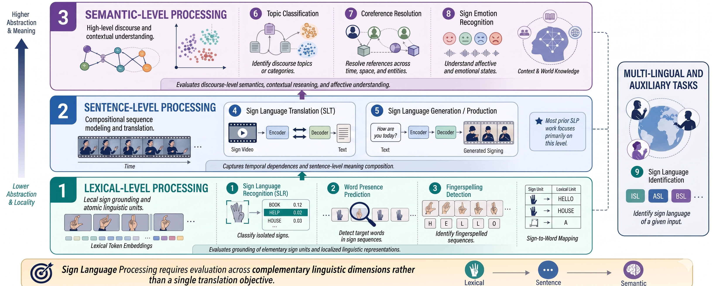

# A Linguistically-Grounded Multi-Level Task Taxonomy for Sign Language Processing

This repository contains the implementation, datasets, and benchmark for **iSanketik**, a unified taxonomy designed to move Sign Language Processing (SLP) beyond isolated end-to-end translation into a multi-level linguistic modeling framework. 

Historically, SLP benchmarks have been heavily translation-centric, obscuring granular model capabilities. This work introduces the first linguistically grounded task taxonomy for SLP, decomposing evaluation into three hierarchical layers—**Lexical-Level**, **Sentence-Level**, and **Semantic-Level** processing—along with cross-linguistic auxiliary tasks.

---

## 📌 Table of Contents
- [Taxonomy Overview](#-taxonomy-overview)
- [Dataset Statistics (iSanketik)](#-dataset-statistics-isanketik)
- [Data Processing Pipeline](#-data-processing-pipeline)
- [Task Specifications & Baseline Architectures](#-task-specifications--baseline-architectures)
- [Experimental Results](#-experimental-results)
- [Repository Structure](#-repository-structure)
- [Installation & Setup](#-installation--setup)
- [Usage Guide](#-usage-guide)
- [Ethical Considerations](#-ethical-considerations)
- [Citation](#-citation)

---

## 🗺️ Taxonomy Overview

Unlike spoken/written languages which flow in a sequential token stream, sign languages are inherently **multimodal and simultaneous**. Meaning is conveyed concurrently through handshapes, movement trajectories, facial expressions, eye gaze, body postures, and spatial coordinates.


*Figure 1: Sign languages are inherently multimodal and simultaneous, meaning is conveyed concurrently through
handshapes, facial expressions, eye gaze, body posture, spatial references, and fingerspelling. These rich linguistic
signals cannot be fully captured through translation alone. In contrast, spoken and written languages rely on
sequential, linear token streams.*

The proposed taxonomy organizes SLP into distinct linguistic dimensions:
1. **Lexical-Level Processing:** Evaluates local grounding and the model's ability to identify individual atomic linguistic units (words, glosses, fingerspelling segments) independent of sentence context.
2. **Sentence-Level Processing:** Assesses compositional sequence modeling, temporal dependencies, syntax mapping, and cross-modal translation or pose generation.
3. **Semantic-Level Processing:** Measures high-level discourse, referential coherence, topical context, and affective state interpretation.


*Figure 2: e formalize our proposed taxonomy for SLP (SLP), organizing tasks into three hierarchical levels:
lexical-level, sentence-level, and semantic-level. Each level captures distinct linguistic competencies that are
conflated in translation-only formulations. We instantiate this taxonomy through a unified benchmark iSanketik,
where existing and newly introduced tasks are mapped to their corresponding levels.*

---

## 📊 Dataset Statistics (iSanketik)

The benchmark comprises newly curated, continuous Indian Sign Language (ISL) video resources and skeleton-based pose representations, totaling **over 515 hours** of continuous signed discourse.

| Taxonomy Level | Task | Task Type | Train Samples | Val Samples | Test Samples | Approx. Total Hours |
| :--- | :--- | :--- | :---: | :---: | :---: | :---: |
| **Lexical-Level** | Sign Language Recognition | One-shot Retrieval | 4,924 | - | 109 | ~15 |
| | Word Presence Prediction (WPP) | Binary Classification | 25,432 | 1,413 | 1,413 | ~17 |
| | Fingerspelling Detection | Binary Classification | 11,154 | 1,394 | 1,395 | ~30 |
| **Sentence-Level** | ISL &rarr; English Translation | Sequence-to-Sequence | 233,412 | 5,653 | 6,069 | ~444 |
| | ISL &rarr; Hindi Translation | Sequence-to-Sequence | 40,205 | 4,251 | 4,010 | ~71 |
| | English &rarr; ISL Generation | Text-to-Pose Synthesis | 233,412 | 5,653 | 6,069 | ~444 |
| | Hindi &rarr; ISL Generation | Text-to-Pose Synthesis | 40,205 | 4,251 | 4,010 | ~71 |
| **Semantic-Level** | Topic Modeling | Unsupervised Clustering| 15,690 | - | - | ~444 |
| | Co-reference Resolution | Pairwise Classification| 110,932 | 13,002 | 13,625 | ~173 |
| | Sign Emotion Recognition | Multi-class (9 classes) | 61,980 | 7,747 | 7,748 | ~171 |
| **Auxiliary Tasks**| Sign Language Identification (SLI)| Multi-class (8 languages)| 329,505 | 30,383 | 39,651 | ~1,007 |

---

## ⚙️ Data Processing Pipeline

The dataset was constructed from high-quality public educational, administrative, and news sources (ISLRTC, ISH News, MBM, SignMedium, Hear a Million, Orjet Foundation).

1. **Timestamp-Based Video Clipping:** Full-length videos were segmented chronologically at sentence level to produce isolated semantic segments.
2. **Region of Interest (ROI) Tracking:** **YOLOv11** was applied to localize and dynamically track signers across time frames, cropping frames to exclude background clutter.
3. **Pose Keypoint Extraction:** 2D skeleton keypoints (152 or 190 coordinate points spanning hands, face, and upper body) were derived using **MediaPipe Holistic**, providing a privacy-preserving representation.
4. **Human Verification:** All split validation and testing splits were manually vetted by certified signers to clear transcript anomalies, occlusions, and alignment errors.

---

## 🧠 Task Specifications & Baseline Architectures

### 1. Lexical-Level Processing
* **Sign Language Recognition (SLR):** Modelled as a zero/one-shot spatial retrieval problem over an I3D spatiotemporal embedding space using Manhattan ($L_1$) similarity metrics.
* **Word Presence Prediction (WPP):** Evaluates if an isolated query sign appears in a candidate continuous video. Leverages a transfer learning setup using a pretrained translation BERT-Transformer backbone fused via an interaction module:
  $$f = [q; s; |q - s|; q \odot s]$$
* **Fingerspelling Detection:** Binary classification identifying fine-grained hand articulation segments using the contextualized BERT-Transformer backbone.

### 2. Sentence-Level Processing
* **Sign Language Translation (SLT):** Converts downsampled pose streams (`STEP_FRAMES = 5`) into natural spoken text (English or Hindi). Uses a hybrid **BERT-Encoder + GPT2 autoregressive Decoder** architecture regularized via **R-Drop KL-divergence consistency constraints**.
* **Sign Language Production (SLP):** A two-stage text-to-pose generation pipeline. Phase 1 trains a **Pose Variational Autoencoder (VAE)** with reconstruction, velocity, and bone-length penalties. Phase 2 leverages a **Diffusion Transformer (DiT)** conditioned on text features (Flan-T5 for English, IndicBERT for Hindi) matching rectified linear flow targets.

### 3. Semantic-Level Processing
* **Topic Modeling:** High-level narrative modeling using a **MoCo v2 self-supervised contrastive pose encoder** combined with **BERTopic** structures. Cluster labels are textually validated against target summaries using Gemini 2.5 Flash context blocks.
* **Co-reference Resolution:** Identifies cross-sentence entity mapping in sign streams using document-level coreference indices derived from text anchors via a dual-tower BERT-Transformer fine-tuned with differential learning rates.
* **Sign Emotion Recognition:** Predicts 9 discrete emotional labels from signing motion and non-manual affective cues using cross-modal distillation strategies.

### 4. Cross-Linguistic Signaling
* **Sign Language Identification (SLI):** Discriminates across 8 international sign languages (ISL, ASL, BSL, CSL, DGS, DSGS, VGT, SSL) from coordinate input using a dedicated 4-layer spatial Transformer encoder with masked temporal aggregation.

---

## 📈 Experimental Results

Baseline evaluation shows a sharp gradient of difficulty as tasks progress to higher abstraction levels, verifying that translation performance alone fails to index rich linguistic capability.

| Task Category | Baseline Model Configuration | Key Metric 1 | Key Metric 2 | Key Metric 3 |
| :--- | :--- | :--- | :--- | :--- |
| **Lexical SLR** | I3D + Cosine/Manhattan Similarity | Top-1 Acc: **25.69%** | Top-2 Acc: **32.11%** | Top-5 Acc: **39.45%** |
| **Lexical WPP** | Pretrained BERT-Transformer + Interaction Head | Test Acc: **82.38%** | Macro-F1: **82.37%** | - |
| **Fingerspelling**| Pretrained BERT-Transformer Encoder | Test Acc: **79.57%** | Macro-F1: **79.50%** | - |
| **SLT (English)** | Hybrid BERT-GPT2 (with R-Drop Optimization) | BLEU-4: **4.20** | SacreBLEU: **4.20** | ROUGE-L: **19.39** |
| **SLT (Hindi)** | Hybrid BERT-GPT2 Architecture | BLEU-4: **1.53** | SacreBLEU: **1.52** | ROUGE-L: **1.15** |
| **SLP (English)** | Two-Stage VAE + DiT (Rectified Flow Matching) | MPJPE: **0.469** | DTW: **3.64** | - |
| **SLP (Hindi)** | Two-Stage VAE + DiT (IndicBERT Conditioned) | MPJPE: **0.530** | DTW: **4.94** | - |
| **Topic Modeling**| MoCo v2 Pose Encoder + BERTopic Cluster Stack | Silhouette: **0.559**| Spearman $
ho$: **0.250**| - |
| **Coreference** | Dual-Tower Pretrained BERT Encoder | Test Acc: **66.16%** | Macro-F1: **66.16%** | - |
| **Emotion Recog.**| Fine-tuned BERT Encoder Block | Test Acc: **57.34%** | Macro-F1: **38.31%** | - |
| **Language ID** | 4-Layer Masked Transformer Encoder | Test Acc: **97.94%** | Macro-F1: **97.36%** | - |

---

## 📂 Repository Structure

<!-- ```directory
├── src/
│   ├── data/                 # Curation and keypoint downsampling pipelines
│   │   ├── clip_videos.py    # Transcript-guided preprocessing
│   │   ├── extract_poses.py  # MediaPipe extraction wrapper
│   │   └── tracking.py       # YOLOv11 tracking setup
│   ├── models/               # Model blueprints
│   │   ├── lexical.py        # WPP and Fingerspelling network wrappers
│   │   ├── translation.py    # BERT-GPT2 hybrid structure
│   │   ├── generation.py     # VAE and Rectified Flow DiT modules
│   │   ├── semantic.py       # MoCo v2, Coref, and Emotion models
│   │   └── sli_encoder.py    # 4-Layer language ID encoder
│   ├── train/                # Unified training scripts
│   └── evaluate/             # Benchmark metrics and evaluation runner
├── data/
│   └── iSanketik/            # Dataset paths placeholder (train/val/test metadata)
├── images/                   # Placeholder folder for README assets
├── configs/                  # Hyperparameter YAML configuration blocks
├── README.md                 
└── requirements.txt          
``` -->

---

## 🛠️ Installation & Setup

1. Clone the repository:
   ```bash
   git clone https://github.com/Exploration-Lab/iSanketik.git
   cd isl-taxonomy-slp
   ```
2. Set up a virtual environment and install dependencies:
   ```bash
   conda create -n isanketik python=3.10 -y
   conda activate isanketik
   pip install -r requirements.txt
   ```
3. Install MediaPipe and hardware acceleration support matching your environment configuration:
   ```bash
   pip install mediapipe ultralytics torch torchvision torchaudio
   ```

---

## 🚀 Usage Guide

### Data Preprocessing
Extract spatial 2D pose landmarks from raw continuous clips:
```bash
python src/data/extract_poses.py --input_dir ./data/raw_clips --output_dir ./data/processed_poses
```

### Model Training
<!-- To train the sentence-level hybrid **Sign Language Translation (ISL &rarr; English)** system:
```bash
python src/train/train_translation.py --config configs/translation_english.yaml --batch_size 512
```

To run the text-to-pose **Sign Language Production** diffusion block:
```bash
python src/train/train_generation.py --config configs/production_dit.yaml --stage 2
```

### Evaluation
Execute evaluation routines across any chosen taxonomy layer:
```bash
python src/evaluate/run_eval.py --task word_presence --checkpoint weights/wpp_best.pt
```

--- -->

## ⚖️ Ethical Considerations

* **Privacy Preservation:** Visual identity, facial details, and recording backgrounds are completely anonymized by relying strictly on mathematical keypoint coordinate structures instead of raw RGB media feeds for model optimization.
* **Linguistic Authenticity:** Taxonomy principles and benchmarks were verified in coordination with certified sign language experts to preserve regional semantics.

---

## 📄 Citation

```bibtex
@inproceedings{anonymous2026slptaxonomy,
  title={A Linguistically-Grounded Multi-Level Task Taxonomy for Sign Language Processing},
  author={Anonymous ACL Submission},
  booktitle={Proceedings of the Association for Computational Linguistics (ACL)},
  year={2026},
  note={Under Review}
}
```
